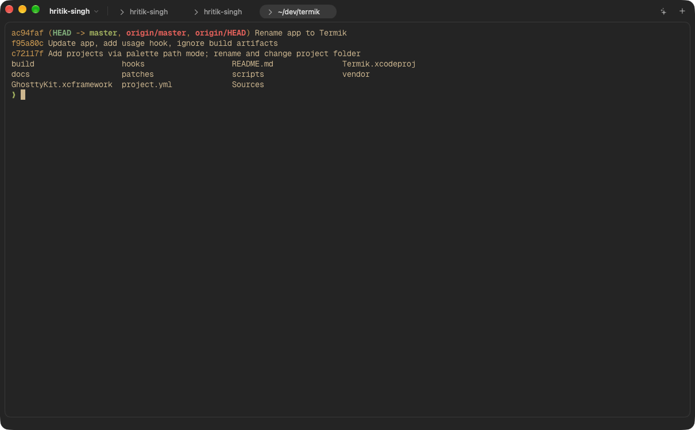
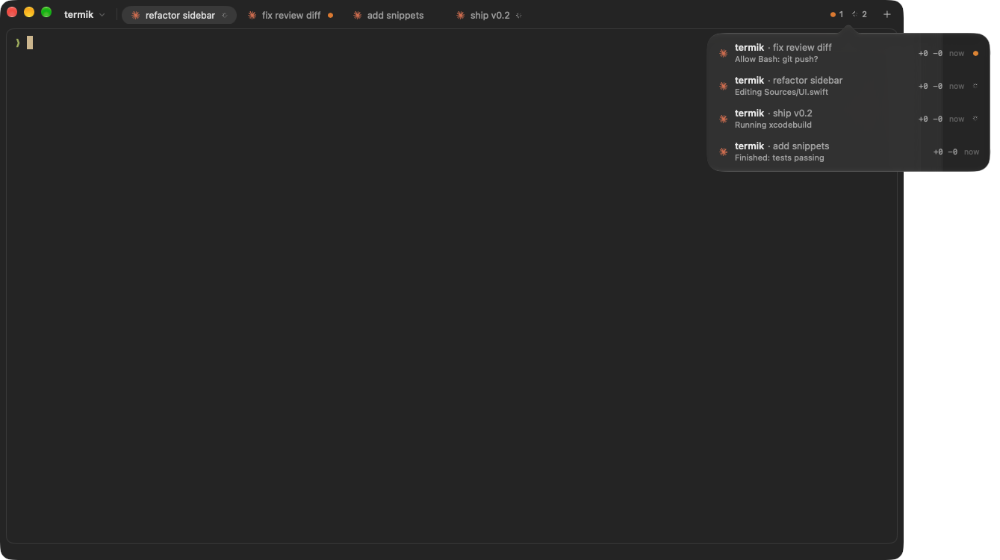

<p align="center"></p>

# Termik

A minimal macOS terminal for coding agents, built on libghostty (renders and reads config exactly like Ghostty).



Several Claude Code agents at a glance: per-tab status, and ⌘⇧A for the full list.



## Install

```sh
brew install --cask hrithik73/tap/termik
xattr -dr com.apple.quarantine /Applications/Termik.app
```

Termik isn't signed or notarized, so macOS flags it; the second command clears that. Apple silicon, macOS 15+.

## Features

- **Projects**: a sidebar of folders, each with its own tabs and splits.
- **Agent status**: every tab shows whether its agent is working, blocked, done or errored ([OSC 7501](https://www.superlogical.com/rex/docs/build/program-status)); ⌘⇧A lists them all, ⌥⌘J jumps to the next one that needs you.
- **Diff review** (⌘⇧R): review changes against `HEAD` in VS Code's diff editor and send comments to the agent.
- **Command palette** (⌘P) and **prompt snippets**: Markdown files in `~/.config/termik/snippets/`, pasted with ⌥⌘1–9.
- **Session resume**: tabs running Claude reopen it with `claude --resume` after a relaunch.

Your Ghostty keybinds keep working. ⌘⇧O adds a project; `open -a Termik <dir>` does too.

## Claude Code

On first launch Termik offers to connect Claude Code (later: **Agents → Connect Claude Code…**). It adds hooks to `~/.claude/settings.json` for tab status and session resume, and wraps your statusLine so the footer shows usage limits. Your file is backed up to `settings.json.bak`.

Any other tool can report status with `/Applications/Termik.app/Contents/Resources/hooks/osc7501 <state> [msg] [kind]`.

## Build

```sh
git submodule update --init
./scripts/build-ghosttykit.sh      # needs Zig 0.16 and Xcode's Metal toolchain
./scripts/fetch-monaco.sh
xcodegen generate && open Termik.xcodeproj
./scripts/test-status.sh && ./scripts/test-hooks.sh
```

`patches/0001-program-status-action.patch` makes libghostty forward OSC 7501 reports to the app.
